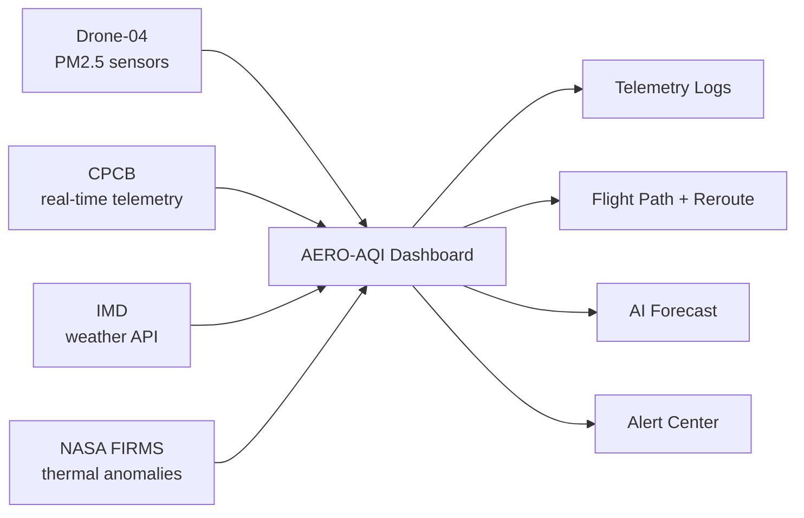

<div align="center">

# 🛸 AERO-AQI

### Autonomous Airborne Pollution Intelligence

*Anti-gravity drone air-quality monitoring & plume tracking over Delhi-NCR*

[](https://github.com/AkshanshPundir/Aero-AQI/actions/workflows/deploy.yml)
[](https://akshanshpundir.github.io/Aero-AQI/)
[](https://akshanshpundir.github.io/Aero-AQI/aero-aqi.html)
[](https://react.dev)
[](https://vite.dev)
[](https://www.typescriptlang.org)
[](./LICENSE)

**[🚀 Live React App](https://akshanshpundir.github.io/Aero-AQI/) · [⚡ Static Dashboard](https://akshanshpundir.github.io/Aero-AQI/aero-aqi.html) · [📖 Docs](#-quickstart)**

</div>

---

## 🌫️ What is this?

A liquid-glass environmental telemetry dashboard for **autonomous UAV air-quality surveillance** across the National Capital Region. Drone-04 streams PM2.5 / AQI readings over hotspot belts while CPCB, IMD and NASA FIRMS feeds fuse into one command view — plume curve, station cards, alerts, flight path and AI forecast.

> Pixel-faithful to a `1357 × 871` reference grid — every size/spacing scales off `--u: min(100vw/1357, 100dvh/871)`.

---

## ✨ Features

| Area | What's inside |
|---|---|
| 🛰️ Telemetry Logs | Live Drone-04 stream, auto-append every 3s, pause / resume / clear |
| 🔥 Satellite FIRMS | 6 thermal-anomaly sites with FRP, confidence, distance + re-sync |
| 📍 Flight Path | 6-waypoint sortie plan, progress bar, one-click plume reroute |
| 🤖 AI Forecasting | +2h → +24h AQI model with confidence %, re-runnable |
| 🔍 Search Station | Fuzzy search across stations, hotspots, sections (`/` to open, `Esc` to close) |
| 🔔 Alert Center | Severity-coded alerts, per-alert read, mark-all-read with live badge count |
| 👤 Command Profile | Akshansh Pundir — Class Lead / NSS Director, sorties, preferences, sign-out |
| 🔌 Disconnect mode | Suspends jitter + streams, freezes cards, one-click reconnect |
| 📊 Wave chart | Animated PM2.5 draw-on curve, hover tooltips, click-to-pin hotspots |
| 🃏 Station rail | Click any neighbour node to focus it as the main station card |

---

## 🕹️ Every control works

<details>
<summary><b>Sidebar</b> — 5 sections + power</summary>

- **Dashboard** — home overview (pip snaps back to top)
- **Telemetry Logs** — drawer with live log buffer
- **Satellite FIRMS** — thermal hotspot table + sync
- **Flight Path** — waypoints + reroute
- **AI Forecasting** — model table + run
- **System Disconnect** — confirm modal → paused link state

</details>

<details>
<summary><b>Header</b> — deploy, search, alerts, avatar</summary>

- **Deploy UAV** — airborne counter `4 → 6`, toast + log entry
- **Search** — live results, keyboard-first
- **Bell** — unread badge clears as you read
- **Avatar** — profile popover with working actions

</details>

<details>
<summary><b>Chart & cards</b></summary>

- Hour chips `08:00 → 18:00` pin the main AQI readout
- Wave dots + hotspot labels pin their hotspot AQI
- Neighbour cards swap the main station (region, AQI, band)

</details>

---

## 🏗️ Architecture



---

## 📁 Project structure

```
AERO-AQI/
├── aero-aqi.html          # ⚡ self-contained static page (no build needed)
├── index.html             # Vite entry → React app
├── public/
│   └── aero-aqi.html      # static page, served at /aero-aqi.html
├── src/
│   ├── main.tsx           # React bootstrap
│   └── aero-aqi/
│       ├── AeroAqi.tsx    # full interactive dashboard
│       ├── data.ts        # stations, hours, hotspots, FIRMS, waypoints, AI rows
│       └── aero-aqi.css   # liquid-glass system (--u grid, keyframes)
├── .github/workflows/
│   └── deploy.yml         # GitHub Pages CI → dist/
└── README.md
```

Two ways to experience it: the **React app** (`/`) and the **zero-dependency static page** (`/aero-aqi.html`) — same design, same data.

---

## 🚀 Quickstart

```bash
git clone https://github.com/AkshanshPundir/Aero-AQI.git
cd Aero-AQI
npm install
npm run dev
```

| Entry | Local URL |
|---|---|
| React app | http://localhost:5174/ |
| Static page | http://localhost:5174/aero-aqi.html |
| Static file (no server) | double-click `aero-aqi.html` |

### Scripts

| Command | Does what |
|---|---|
| `npm run dev` | Vite dev server (port 5174) |
| `npm run build` | `tsc -b` + production build → `dist/` |
| `npm run type-check` | Type-check only |
| `npm run preview` | Preview the production build |

---

## 🌐 Deployment

Push to `main` → the **Deploy to GitHub Pages** workflow builds and publishes `dist/` automatically.

| Surface | URL |
|---|---|
| React app | https://akshanshpundir.github.io/Aero-AQI/ |
| Static dashboard | https://akshanshpundir.github.io/Aero-AQI/aero-aqi.html |

> First time only: repo **Settings → Pages → Source → GitHub Actions**.

---

## 📡 NCR station belt

| Station | Region | AQI | Band |
|---|---|---|---|
| Anand Vihar Terminal | New Delhi | **412** | Severe + |
| Shastri Nagar Node | Meerut, UP | 328 | Severe |
| Knowledge Park Node | Greater Noida, UP | 352 | Severe |
| Cyber City Node | Gurugram, HR | 284 | Very Poor |

*Data attribution: **CPCB** real-time telemetry · **IMD** weather API · **NASA FIRMS** thermal anomaly satellite data.*

---

## 🗺️ Roadmap

- [ ] Live CPCB API wiring (replace simulated jitter)
- [ ] Drone fleet view (Drone-01 → 06 on one map)
- [ ] Push alerts (Web Push) for Hazardous spikes
- [ ] Hindi language toggle for public advisories

---

## 🤝 Contributing

PRs welcome — fork, branch off `main`, `npm run build` green, then open the PR.

## 👨‍✈️ Author

**Akshansh Pundir** — Class Lead / NSS Director · Drone-04 NCR sector

## 📄 License

[MIT](./LICENSE) © Akshansh Pundir
